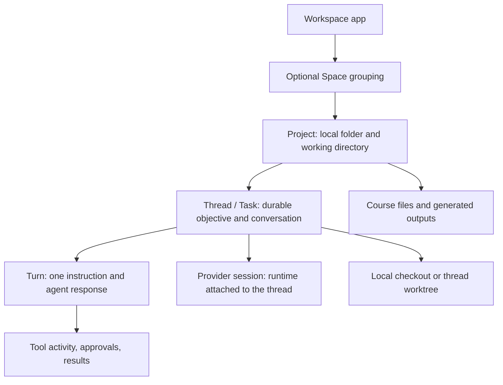

<!-- to-plan:conversation-plan:v1 id=00664167-153b-4ed7-b967-d71ffb99eebb -->

# Mimir student-first course workspace V1

**Planned against:** `main` at `35f684b93e0693db517fe97389c242dd7d0ed7a5`
**Local state:** Clean

## Approved source contract

Build the first usable student-first learning flow in Mimir's web app. A student should open one course workspace, add or find course material, choose a learning goal, study with the agent, save useful notes or practice material, and return later to the right course and study.

Acceptance criteria:

1. The app opens or resumes one selected course at a time. A missing or stale course selection lands on a course picker, not an unrelated global chat.
2. A student can create a course from one local folder or open an existing local folder. The course home makes the course name, Inbox materials, Outbox outputs, current study, and next learning actions clear.
3. The student can start a guided study chat from the selected course. Drafts, threads, turns, and provider sessions keep their current ownership and lifecycle; a study chat cannot silently start in another course. New study work stays in the course's local folder by default.
4. Course instructions and guided actions encourage explaining, reviewing source material, and practicing. Agent-created material goes under the existing `Outbox/<Category>/` convention; existing student files and custom instructions are preserved.
5. The course flow uses the current Mimir web semantic tokens and components consistently in light and dark themes, at the user's selected text scale, and at narrow widths. Material 3/M3E is not reintroduced.

Scope decisions: treat one ordinary `Project` folder as one course workspace in the student UI. Reuse its existing `ProjectId` and `cwd`; do not add a `course` `ProjectKind` or a new persistence entity. Keep Spaces as secondary legacy organization, and do not move, rename, or migrate existing project data automatically. Keep Git, provider/model configuration, split chat, Hubs, Automations, and other advanced surfaces out of the default student path while retaining their existing routes and data.

This plan covers the web learning flow and the server-side course-folder setup it needs. It does not change provider session lifecycle or permission policy. A separate launch gate remains: the current default runtime mode is `full-access` (`packages/contracts/src/orchestration.ts`); resolve the student permission posture before calling a public student release stable.

## Current flow map

**Ownership:** a Space groups Projects through `Project.spaceId`; a Project owns a folder; a Thread owns a `projectId`, transcript, many Turns, and a nullable `ThreadSession`. A Thread has no `spaceId`. The provider session is runtime state attached to a Thread, not the course or the transcript itself. One course can retain several study Threads, with one open at a time in the proposed student UI.

**Current arrival and navigation:**

1. `/` (`apps/web/src/routes/_chat.index.tsx`) restores the globally remembered thread/draft, or creates a home-chat draft. It does not currently make a course the default destination.
2. The Space switcher selects a Space and navigates to that Space's remembered Thread, remembered Project board, most recent Thread, or an empty Space landing (`useSpacesController.ts`, `spaceNavigation.ts`). Active Space and per-Space context are stored in `sessionStorage` by `spacesUiStore.ts`.
3. `/$threadId` resolves a draft or saved Thread and renders `SingleChatSurface` or a persisted `SplitChatSurface`. `?view=editor` swaps to `EditorWorkspaceView`, a code-oriented file/diff/chat layout.
4. New chat starts as a local composer draft. The first send promotes it to a durable Thread; provider startup follows normal setup/dispatch. Worktree preparation, when selected, completes before the provider session starts. Later messages are additional Turns in that Thread.
5. The shell exposes Home, Spaces, Tasks, Code review, Automations, Hubs, and Settings. Saved chat tabs, the command palette, Kanban, and Inbox add more ways to branch away from the current course.

**Course capability gap:** `studioWorkspaceScaffold.ts` already defines student folders (`Inbox`, `Outbox/*`, and `.mimir/*`) and course-oriented file rules, but `wsRpc.ts` currently wires this setup to the special Studio/container path. `studio.listThreadOutputs` also rejects ordinary Project threads. The ordinary Project course flow therefore needs an explicit, project-scoped setup and course-file presentation; it must not be implemented by adding another Project kind.

## Approach

Make the ordinary Project folder the student-facing Course. Replace the global home-chat default with a course picker/resume decision, then present a focused course workspace with a single active study conversation. Build course setup from existing project creation and folder-reveal/file-list APIs. Start guided study through the existing Thread draft/send path, and use the existing Inbox/Outbox folder convention for source materials and saved work. Apply the current web design system to the entire flow and move coding-oriented navigation behind secondary access.

## Guardrails

- Keep `Project`, `Thread`, `Turn`, provider session, workspace, transcript, recovery, approval, and file-containment contracts intact. A course is a presentation role over an ordinary Project folder.
- Do not overwrite or reorganize an existing course folder. Creating a new course may scaffold missing folders. Preparing an existing folder must be explicit, idempotent, path-scoped to its registered Project, and preserve any custom `AGENTS.md` or `CLAUDE.md`.
- Do not persist transcripts, prompts, or file contents in the course-selection preference store. Persist identifiers only and reconcile them against hydrated Projects and Threads before navigation.
- Reuse `apps/web/src/index.css` semantic tokens, `components/ui/*`, `text-ui` typography, and established dialog/sidebar patterns. Do not add a second token system or fixed UI text sizes.
- Preserve current provider permission behavior in this plan; do not hide approval requests or describe UI hiding as a security control.
- Keep implementation within the student course flow. Do not redesign unrelated surfaces or delete advanced capabilities.
- For routine implementation and fixture corrections within this contract, record the correction and renew affected evidence. A factual plan mismatch allows one focused diagnosis and at most two repair cycles. Replan for a changed user-visible contract, data migration, provider security policy, or exhausted repair allowance.

## Planning decisions

- **Course means one ordinary Project folder.** The repository defines Project as the local folder and Thread as its durable work unit (`docs/core-concepts.md`, `apps/web/src/types.ts`). This maps cleanly to a course folder and avoids a schema migration or a second grouping layer in the default UI. Spaces and existing multi-project groupings remain intact outside the focused student path.
- **Resume is course-scoped.** The global last-thread route can otherwise reopen a different Project. Course selection and course-specific recent Thread state must be reconciled before restoring a route; an unknown/deleted ID returns to the course picker/home safely.
- **Student outputs stay as files.** Use the existing categorized Outbox structure and Project file APIs for viewing; do not add an artifact entity or per-Thread `spaceId` as part of V1.
- **The web implementation is the design authority.** Impeccable context found no `PRODUCT.md` or `DESIGN.md` under `apps/web`, but the app has an established visual system. The user's choice is to keep its semantic tokens and components as the base, so this work extends those patterns rather than treating the missing docs as permission for a visual reset.
- **The current permission default is a separate release decision.** `DEFAULT_RUNTIME_MODE` is `full-access`; changing it affects provider/security policy and is intentionally outside this UX plan. The stable-release owner must close that gate before public student release.

## Implementation context

- **Existing:** `apps/web/src/routes/_chat.index.tsx` — cold-start restore/create entry point; delegates to `RestoreOrCreateChatRoute` and `resolveChatIndexRestoreRoute`.
- **Existing:** `apps/web/src/routes/-chatIndexRoute.logic.ts` — restores a route and already rejects Threads that cannot be reached from a selected Space; extend the same fail-closed pattern to a selected course Project.
- **Existing:** `apps/web/src/spacesUiStore.ts` and `apps/web/src/components/useSpacesController.ts` — session-persisted Space selection and per-Space remembered Thread/Project; do not overload this Space model as a Course.
- **Existing:** `apps/web/src/types.ts` — `Project` owns `cwd`; `Thread` owns `projectId`, `session`, messages, and turn state; `ThreadSession` is nullable runtime state.
- **Existing:** `apps/web/src/hooks/useHandleNewThread.ts`, `apps/web/src/lib/threadCreatePromotion.ts`, and `apps/web/src/components/chat/useChatTurnExecution.ts` — local draft, first-send promotion, and normal provider startup path.
- **Existing:** `apps/web/src/lib/projectCreation.ts` and `apps/web/src/components/CreateProjectDialog.tsx` — create/recover an ordinary local Project and preserve duplicate-folder behavior.
- **Existing:** `apps/web/src/lib/revealFolder.ts` and `NativeApi.projects.listDirectories` — reveal the Inbox in the OS file manager and list files under Inbox/Outbox without introducing a new file transport.
- **Existing:** `apps/server/src/studioWorkspaceScaffold.ts` and `apps/server/src/wsRpc.ts` — student folder/instruction helpers currently attached to Studio/container setup; expose a scoped course-Project preparation seam without broadening Studio output semantics accidentally.
- **Existing:** `apps/web/src/components/EditorWorkspaceView.tsx` — file explorer, search, previews, diff, and chat in an editor-style view; useful as a secondary course-files surface, not the default learning landing.
- **Follow:** `apps/web/src/components/SpaceEmptyState.tsx`, `CreateProjectDialog.tsx`, and `components/ui/dialog.tsx` for concise empty states, creation flows, and existing Base UI patterns.
- **Follow:** `apps/web/src/components/EditorWorkspaceView.browser.tsx` for light/dark and selected-font-scale browser assertions; `apps/web/src/uiFontSize.test.ts` for typography constraints.

## Implementation slices

**Task graph and parallelism:** The graph is a single sequence because the route decision feeds the course shell, which feeds study and file presentation: `T1 → T2 → T3 → T4`. No slices are safe to implement concurrently; all touch the route/shell contract.

### 1. Course-scoped entry and resume

**Task ID:** `T1`
**Depends on:** `none`
**Prerequisites:** None.
**Files and symbols:** Add `apps/web/src/courseWorkspaceStore.ts` and its unit test; extend `apps/web/src/routes/-chatIndexRoute.logic.ts` with a course entry resolver and add `-chatIndexRoute.logic.test.ts`; wire `apps/web/src/routes/_chat.index.tsx`. Reuse shell hydration in `store.ts` and current route restore helpers.
**Test:** Verify persisted course IDs survive a reload; valid active course with no Thread resolves to course home; a valid recent Thread resolves only when its `projectId` matches the selected course; deleted/unknown course or Thread IDs fall back to course selection; no transcript or file content is stored in the preference state.
**Implementation:** Persist active `ProjectId` and recent `ThreadId`-by-Project identifiers only. Reconcile after shell hydration, fail closed on stale IDs, and make `/` resolve to course home, a course-scoped recent Thread, or the course picker. Do not fall through to the global home-chat draft when student course state is absent or invalid. Keep explicit deep links to an existing Thread functional.
**Validate:** From `/home/itshimelz/Harness/mimir`, after dependencies are installed, run `bun run --cwd apps/web test -- src/courseWorkspaceStore.test.ts src/routes/-chatIndexRoute.logic.test.ts`; expect all persistence and route-boundary cases to pass. Then run `bun run --cwd apps/web typecheck`; expect exit code 0.
**Complete when:** Cold start, reload, course switch, missing data, and direct Thread links all resolve without opening a Thread from another course.

### 2. Course creation and focused workspace home

**Task ID:** `T2`
**Depends on:** `T1`
**Prerequisites:** T1 route resolver and persistence tests pass.
**Files and symbols:** Add `apps/web/src/components/CourseWorkspaceHome.tsx` and `CreateCourseDialog.tsx`; integrate in `_chat.index.tsx`. Reuse `createOrRecoverProjectFromPath` and `CreateProjectDialog` patterns. Add a `course.prepareWorkspace` method to `packages/contracts/src/ws.ts` and its `NativeApi`/transport wiring in `packages/contracts/src/ipc.ts`; implement a project-ID-scoped handler in `apps/server/src/wsRpc.ts` using `apps/server/src/studioWorkspaceScaffold.ts`. Cover path preparation in `apps/server/src/studioWorkspaceScaffold.test.ts` and lookup/kind rejection in a new `apps/server/src/wsRpc.courseWorkspace.test.ts`, following the fake dependency seam in `wsRpc.projectWorktree.test.ts`.
**Test:** Browser-test first-run with no course, successful new-course creation, existing-folder selection, empty Inbox/Outbox, folder-open failure, and retry. Server-test that preparation resolves a registered ordinary `ProjectId`, creates only missing student directories, is idempotent, rejects non-course/container kinds, and preserves custom root instruction files.
**Implementation:** Create one local folder-backed ordinary Project per course; no GitHub choice, extra source-folder picker, or new `ProjectKind` in the student creation path. New courses may scaffold `Inbox`, `Outbox/Lessons`, `Assignments`, `Handouts`, `Notes`, `Quizzes`, `References`, `Images`, and `.mimir/*`. Preparing an existing folder is a named action that explains these additions and never overwrites student files. The home shows course identity, current folder, a prominent **Continue study** action, concise **Explain**, **Review material**, and **Practice** actions, plus Inbox and Outbox summaries. **Add materials** reveals the registered course's `Inbox` using `revealFolderInShell`; Outbox files open through the existing Project file preview. Use semantic tokens and existing buttons/cards/dialogs for loading, empty, error, and success states.
**Validate:** From the repository root, run `bun run --cwd apps/web test:browser -- src/components/CourseWorkspaceHome.browser.tsx` and `bun run --cwd apps/server test -- src/studioWorkspaceScaffold.test.ts src/wsRpc.courseWorkspace.test.ts`; expect each focused browser/server suite to pass. Run `bun run --cwd apps/web typecheck` and `bun run --cwd apps/server typecheck`; expect exit code 0.
**Complete when:** A student can create or connect one course folder, reach its home, place materials in Inbox, and find saved outputs without seeing unrelated projects in the active workspace.

### 3. Guided study and saved learning work

**Task ID:** `T3`
**Depends on:** `T2`
**Prerequisites:** T2 home and project-scoped folder preparation pass.
**Files and symbols:** Add `apps/web/src/lib/courseStudyPrompts.ts` with unit tests; wire course actions through `useHandleNewThread` and existing composer draft/send behavior. Update student guidance in `apps/server/src/studioWorkspaceScaffold.ts` only through the managed-template path; add `apps/web/src/components/CourseStudyFlow.browser.tsx` and scaffold-content tests.
**Test:** From the course home, each intent creates/reuses a local draft whose `projectId` is the selected course. Sending once promotes the draft once and opens the normal provider flow; switching away and back preserves an unsent draft; the correct recent Thread resumes after reload. Verify prompts use course files, explain concepts, and practice one question at a time. Verify generated instructions ask the agent to preserve Inbox/source material and place completed notes, lessons, and quizzes under categorized Outbox paths; custom user instructions remain untouched.
**Implementation:** Seed a clear learning prompt for each action: explain a topic with a comprehension check; review a selected source and point back to it; quiz one question at a time and wait for the student's answer; help break down an assignment by teaching its concepts. Start new course study Threads in Local mode so source material and Outbox files stay in the registered course folder; keep explicit Git/worktree controls secondary. Keep model/provider and advanced execution settings in their existing secondary controls; preserve all existing approval requests. Use the current Thread as the study conversation and its provider session as the runtime—do not create a parallel StudySession entity. In the managed student instruction template, add learning-partner guidance and update only absent or provably app-generated content; never replace a customized `AGENTS.md` or `CLAUDE.md`. Show existing Inbox/Outbox files through scoped Project file listing and preview; do not create a new artifact database or expose hidden `.mimir` internals.
**Validate:** From `/home/itshimelz/Harness/mimir`, run `bun run --cwd apps/web test -- src/lib/courseStudyPrompts.test.ts` and `bun run --cwd apps/web test:browser -- src/components/CourseStudyFlow.browser.tsx`; run `bun run --cwd apps/server test -- src/studioWorkspaceScaffold.test.ts`; expect prompt assertions, selected-course `projectId`, `envMode: "local"`, draft promotion exactly once, and safe instruction-update cases to pass. Run `bun run --cwd apps/web typecheck` and `bun run --cwd apps/server typecheck`; expect exit code 0.
**Complete when:** Learning actions stay inside the selected folder, use the existing Thread/session lifecycle, and a student can leave and resume both the conversation and its saved course files.

### 4. Reduce competing paths and review the whole flow

**Task ID:** `T4`
**Depends on:** `T3`
**Prerequisites:** The full create → add material → study → save → resume journey works in the focused browser tests.
**Files and symbols:** Update student-facing navigation in `apps/web/src/components/Sidebar.tsx`, related sidebar route logic, course workspace components, and `apps/web/src/components/CourseWorkspace.browser.tsx`. Keep underlying routes and data for advanced surfaces.
**Test:** Browser-test that the default student shell exposes the selected course, its study history, and next study action without presenting project groups, code review, automation, or hub navigation as parallel primary destinations. Verify keyboard focus/names, first-run/loading/error/retry states, light/dark themes, user font scale, 320px width, and 200% zoom without clipped or unreachable controls.
**Implementation:** In the student workspace, show one selected course and one active Thread. Put past Threads in the course's study history instead of opening multiple course/chat tabs by default. Move Spaces and coding-oriented destinations behind a secondary **More**/advanced entry point; do not delete or disable their routes. Consolidate repeated spacing, surfaces, labels, and actions by reusing current Mimir UI primitives. Perform one bounded `better-interface` review across accessibility, layout, writing, typography, color, and UI polish; fix confirmed issues in one batch, then do one confirmation pass. Run Impeccable's mechanical detector once on the changed web UI targets.
**Validate:** From the repository root, run `bun run --cwd apps/web test:browser -- src/components/CourseWorkspace.browser.tsx` and `bun run --cwd apps/web test -- src/uiFontSize.test.ts`; expect the navigation, responsive, theme, keyboard, and typography assertions to pass. Run `! rg -n -i 'm3e|material.?3' apps/web/src`; expect no M3E component or styling references in the web source. From `/home/itshimelz/Harness/mimir/apps/web`, run `/home/itshimelz/.agents/skills/impeccable/scripts/impeccable detect --json src/routes/_chat.index.tsx src/components/CourseWorkspaceHome.tsx src/components/CreateCourseDialog.tsx src/components/CourseStudyFlow.browser.tsx src/components/CourseWorkspace.browser.tsx src/components/Sidebar.tsx` once; expect no unresolved detector error for the changed paths.
**Complete when:** One student can finish and resume the full course workflow without competing workspace entry points, and the interface passes its focused responsive/accessibility/design checks.

## Acceptance coverage

| Acceptance criterion | Slice | Verification |
| --- | ---: | --- |
| Resume one valid course and never restore a Thread from another course | 1 | Store and route-resolver unit cases |
| Create/open a course and find Inbox/Outbox from a focused home | 2 | Course home browser suite and scaffold tests |
| Start learning actions in the selected course, preserve draft/session lifecycle, and save/resume learning work | 3 | Prompt unit tests, study-flow browser suite, scaffold tests |
| Keep the student shell coherent, accessible, responsive, and based on Mimir tokens/components | 4 | Course workspace browser suite, UI font-size test, Impeccable detector, bounded interface review |
| Do not reintroduce M3E | 4 | Source search under `apps/web/src` |

## Final validation

- From `/home/itshimelz/Harness/mimir`, run `bun run fmt:check`, `bun run lint`, `bun run typecheck`, `bun run test:web:focused`, `bun run --cwd apps/web test:browser -- src/components/CourseWorkspaceHome.browser.tsx src/components/CourseStudyFlow.browser.tsx src/components/CourseWorkspace.browser.tsx`, and `bun run --cwd apps/server test -- src/studioWorkspaceScaffold.test.ts src/wsRpc.courseWorkspace.test.ts`; expect all commands to exit 0.
- Run a final desktop and narrow-width manual pass through: create course → open Inbox → start each study intent → save one note and one quiz → switch course → return to the first course → resume its latest Thread. Confirm the saved files remain in the course folder and no other course Thread opens.
- The current public-student runtime permission gate remains unresolved by this plan; do not describe the UX milestone as a stable public release until that policy is decided and validated for the exposed providers.

## Review focus

- Route restoration races with initial shell hydration and must not create a global home draft before course selection settles.
- Course-folder setup is a consequential filesystem boundary: resolve by registered `ProjectId`, create only intended missing paths, report failures with a retry path, and preserve user-owned files.
- The current scaffold/output pipeline is Studio/container-specific. Reuse the folder conventions without accidentally routing an ordinary course through Studio-only `ProjectKind` or `studio.listThreadOutputs` behavior.
- Make learning assistance visible without weakening approval controls or implying that the app can verify academic-policy compliance.
